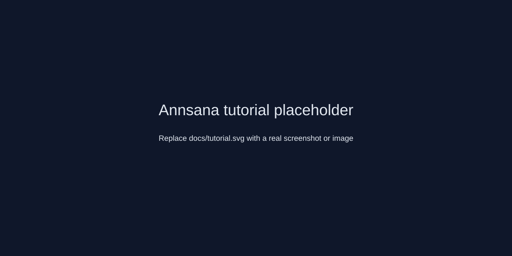

<div align="center">

# Annsana

**A community-focused platform bridging social expression with an archival research knowledge base focused on African cultural heritage.**

A Django scaffold: feed (Instagram-style) + wiki/archive (knowledge base) — Phase 1 scaffold and developer-facing docs.



</div>

---

> [!IMPORTANT]
> This README is a visual sync derived from Blueturboguy07/cue to give Annsana a polished layout and developer-friendly entry. Replace placeholder images and badges after merging.

---

## Quick summary

- Stack: Django · PostgreSQL · HTMX · Tailwind CSS
- Status: Phase 1 scaffold (feed app in active development)
- License: Apache-2.0 (recommended) — see LICENSE

---

## What this repo contains

A lightweight Django scaffold intended to bootstrap a social feed + archival wiki for African cultural heritage.

| Component | Purpose |
|---|---|
| config/ | Project config (split settings: development / testing / production) |
| apps/users/ | Custom user model and profile views |
| apps/feed/ | Posts, multi-image carousels, likes, comments (HTMX) |
| static/ | Tailwind output + design tokens |
| templates/ | Base template + app templates |

---

## Install (developer)

```bash
python -m venv .venv && source .venv/bin/activate
pip install -r requirements.txt
cp .env.example .env          # then edit SECRET_KEY / DATABASE_URL
python manage.py migrate
python manage.py createsuperuser
python manage.py runserver
```

Settings default to `config.settings.development`. For production, set `DJANGO_SETTINGS_MODULE=config.settings.production` and provide a real `SECRET_KEY`, `DATABASE_URL`, and `ALLOWED_HOSTS` via environment variables.

---

## Run tests (no DB connection required)

```bash
DJANGO_SETTINGS_MODULE=config.settings.testing python manage.py test
```

---

## Development notes

- The feed app uses a separate `PostImage` model to support multi-image carousels without later schema changes.
- HTMX drives partial updates for likes/comments to avoid full page reloads.
- Known gap: login/signup views/templates are not implemented yet; `LoginRequiredMixin` redirects to `/accounts/login/`.

---

## Contributing

See CONTRIBUTING.md for contribution guidelines. Issues and PRs welcome.

---

## License

This repository is licensed under the Apache License, Version 2.0. See the LICENSE file for details.
